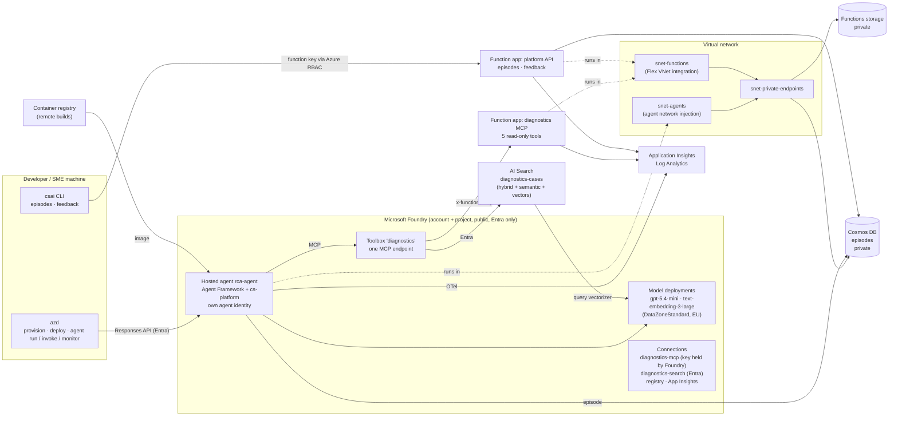

# Architecture

The sample is a minimal CS AI platform with one agent on it. The platform provides the cross-cutting parts once (model access, tools, knowledge, episodes, telemetry, deployment); the RCA agent is a spec, instructions, an output schema and its test cases.

## Components



## Capabilities and where they live

| Capability ([spec §5](specification.md#5-platform-capabilities)) | Implementation |
|---|---|
| **C1** Agent harness | `packages/cs-platform`: `AgentSpec`, `build_agent()`, settings, telemetry. An agent is `agent.spec.yaml`, `instructions.md` and a Pydantic output schema. |
| **C2** Model access | Foundry model deployments (`chatModel` and `embeddingModel` in `infra/main.bicep`, DataZoneStandard). Agents read the deployment name from configuration only. |
| **C3** Tool layer | `services/diagnostics-mcp` (MCP server on Azure Functions) behind the Foundry toolbox `diagnostics`; the function key lives only in a Foundry connection. |
| **C4** Knowledge grounding | AI Search index `diagnostics-cases` (historical cases): keyword, semantic and vector search with a Foundry vectorizer, through the same toolbox. Seeded by `scripts/setup_platform.py seed-search`. |
| **C5** Episode store | `cs_platform.capture` records every run (input, tool calls with arguments, results and durations, structured output, tokens, trace ID) in Cosmos DB. Feedback is patched on through the platform API. |
| **C6** Observability | OpenTelemetry to Application Insights ([below](#observability)). |
| **C7** Evaluation | Foundry calls the hosted agent on 50 test cases (`azd ai eval`); two built-in judges report, six code evaluators score against the answer key, and `rca_evals.gate` decides pass or fail ([eval guide](../evals/rca/README.md#evaluation), [ADR 0007](adr/0007-foundry-evaluation-and-measured-gate.md)). |
| **C8** Identity and security | Entra everywhere; `disableLocalAuth` on Foundry, Cosmos DB and Search; no shared keys on storage; data stores private ([ADR 0003](adr/0003-private-data-stores.md)). Two function keys remain: the MCP server's, held only by a Foundry connection, and the platform API's, which `csai` fetches with your Azure sign-in (backlog S1). |
| **C9** Delivery path | Bicep and azd (`azd up` from an empty subscription), pre-commit gates, a documented pipeline ([CI/CD](ci-cd.md)). |

## A diagnosis, end to end

1. `azd ai agent invoke "M-0001: ..."` (or the playground, or any Responses client) sends the incident to the hosted agent's Responses endpoint with the user's Entra token.
2. Foundry starts or reuses a session of the `rca-agent` container in the agent subnet.
3. The harness opens an episode. Agent Framework runs the model loop: the model calls `get_machine_context`, `get_error_events`, `lookup_error_code`, `get_telemetry_window`, `get_logbook` and `azure_ai_search` through the toolbox, and the capture middleware records every call.
4. The model returns an `RcaReport` (strict structured output): ranked hypotheses, each with cited refs.
5. The harness writes the episode to Cosmos DB over its private endpoint, as the agent's identity. Saving is best effort: if it fails, the caller still gets the report, and the agent logs "Could not save episode …".
6. The episode stores the host-issued Responses ID (`hosted_response_id`), so a response can be matched to its episode. `csai episodes` reads episodes through the platform API, and an expert attaches a verdict with `csai feedback`.

## Identities and access

| Identity | Gets | Defined in |
|---|---|---|
| Developer (azd principal) | Foundry User, AcrPush; Cosmos DB data contributor; Search service and index data contributor | `developer-access.bicep`, `cosmos.bicep`, `search.bicep` |
| Foundry project (system-assigned) | AcrPull; Log Analytics Reader; Foundry User; Search service and index data contributor | `foundry.bicep`, `search.bicep` |
| Foundry account (system-assigned) | Search service and index data contributor (AI Search tool) | `search.bicep` |
| Search service (system-assigned) | Cognitive Services OpenAI User on the Foundry account (query vectorizer) | `search.bicep` |
| Hosted agent (agent identity) | Project endpoint by default; Cosmos DB data contributor | `scripts/setup_platform.py grant-agent` (exists only after deploy) |
| MCP app (user-assigned) | Storage blob/queue/table data roles; Monitoring Metrics Publisher | `function-app.bicep` |
| Platform API (user-assigned) | As the MCP app, plus Cosmos DB data contributor | `function-app.bicep`, `main.bicep` |

Cosmos DB data roles are Cosmos DB's own role assignments, not in the portal's IAM blade: `az cosmosdb sql role assignment list -g $RG -a $COSMOS_ACCOUNT_NAME`.

## Network

Storage and Cosmos DB have public access disabled (also enforced by policy in the original subscription) and private endpoints in `snet-private-endpoints` with private DNS zones ([ADR 0003](adr/0003-private-data-stores.md)). The function apps use VNet integration (`snet-functions`). The hosted agent runs in the delegated `snet-agents` through Foundry agent network injection, which is set when the Foundry account is created. Foundry, the registry and AI Search stay public with Entra-only access, so developers can deploy from their machines.

Evaluation storage is a separate account: public networking, shared keys and anonymous blobs disabled, a blob private endpoint, and Blob Data Contributor for the Foundry project only. Its firewall allows trusted Azure services, because Foundry's evaluation service doesn't reach it through the private endpoint ([ADR 0006](adr/0006-evaluation-storage-network-exception.md)).

To check it: `az network private-endpoint list -g $RG -o table`, and `az cosmosdb show -g $RG -n $COSMOS_ACCOUNT_NAME --query "{public:publicNetworkAccess, localAuthDisabled:disableLocalAuth}"`.

## Observability

The agent, the MCP server and the platform API send OpenTelemetry traces and logs to Application Insights, and Foundry adds spans for its Responses layer. Each episode records its trace ID (the `OperationId`), so an expert's verdict leads to the exact model and tool calls behind it. Traces can be sampled and expire with the workspace's retention, so the episode is the durable record and the trace ID links the two. The [walkthrough](walkthrough.md#5-review-the-episode-and-its-trace) has the query.

- **Hosted agent:** Foundry's hosting library owns telemetry: the exporter, sampling and shutdown. The agent doesn't set up a second provider.
- **Local runs** (`rca-local`): `cs_platform.telemetry` sets up the Azure Monitor exporter when `APPLICATIONINSIGHTS_CONNECTION_STRING` is set, and flushes before exit. Sampling defaults to `parentbased_always_on`; `OTEL_TRACES_SAMPLER` overrides it.
- **The episode span:** the capture middleware starts a `cs_platform.episode` span, which parents Agent Framework's `invoke_agent`, model and tool spans, including for streamed and failed runs. Spans carry `cs_platform.episode_id`. Initialization and tool discovery can happen before it.
- **Functions:** the host uses adaptive sampling with requests excluded.
- **The gap:** the tool server's spans don't join the agent's trace ([findings](foundry-findings.md#traces-stop-at-the-toolbox)). This query shows whether that has changed: `joinedRows` above zero means it has.

```kusto
let agents = union AppRequests, AppDependencies
    | where TimeGenerated > ago(2d) and Name startswith "invoke_agent"
    | distinct OperationId;
AppRequests
| where TimeGenerated > ago(2d) and Name == "get_machine_context"
| summarize handlerRows=count(), joinedRows=countif(OperationId in (agents))
```

## Deployment

`azd up` runs, in order:

1. Bicep (`infra/main.bicep`): network, monitoring, Foundry, registry, Cosmos DB, AI Search, connections, function apps and roles. Its outputs become the azd environment.
2. `postprovision`: create and seed the search index.
3. Services: package the function apps (`scripts/package_function.sh`, locked Linux wheels) and deploy them. The MCP app's `postdeploy` stores its key in a Foundry connection and publishes the toolbox, which needs the key and so can't be Bicep ([ADR 0005](adr/0005-infrastructure-as-code.md)). Then export the locked requirements, build the agent image in the registry and create a hosted agent version. The agent's `postdeploy` grants its new identity the Cosmos DB role.

**Before reprovisioning an existing environment,** check the subnets' security groups. If any were attached outside this template (for example by policy), keep their IDs in the azd environment, never in tracked files:

```bash
azd env set PRIVATE_ENDPOINT_SUBNET_NSG_ID <existing-private-endpoint-subnet-nsg-id>
azd env set FUNCTIONS_SUBNET_NSG_ID <existing-functions-subnet-nsg-id>
azd env set AGENTS_SUBNET_NSG_ID <existing-agents-subnet-nsg-id>
```

An empty value declares no security group and removes an existing association. The template also declares the live Cosmos DB automatic-failover setting, project-only connection visibility, account project routing and the models' RAI and upgrade policies, so reprovisioning doesn't reset them. Review the full what-if before applying ([findings](foundry-findings.md#what-if-shows-changes-that-arent-real-and-hides-some-that-are)).
