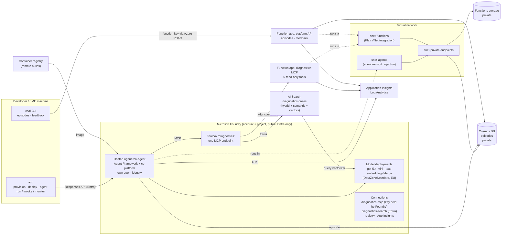

# Architecture

The sample is a minimal CS AI platform with one agent on it. The platform provides the cross-cutting parts once (model access, tools, knowledge, episodes, telemetry, deployment); the RCA agent is a spec, instructions, an output schema and its test cases.

## Components



## Capabilities and where they live

| Capability (spec §5) | Implementation |
|---|---|
| **C1** Agent harness | `packages/cs-platform`: `AgentSpec`, `build_agent()`, settings, telemetry. An agent is declared by `agent.spec.yaml` + `instructions.md` + a Pydantic output schema. |
| **C2** Model access | Foundry model deployments (parameters in `infra/main.bicep`); agents read the deployment name from configuration only. |
| **C3** Tool layer | `services/diagnostics-mcp` (MCP server on Azure Functions) behind the Foundry toolbox `diagnostics`; the function key lives only in a Foundry connection. |
| **C4** Knowledge grounding | AI Search index `diagnostics-cases` (historical cases), keyword + semantic + vector search with a Foundry vectorizer, exposed through the same toolbox. Seeded by `scripts/setup_platform.py seed-search`. |
| **C5** Episode store | `cs_platform.capture` middleware records every run (input, tool calls with arguments, results and durations, structured output, tokens, trace ID) in Cosmos DB; feedback is attached through the platform API. |
| **C6** Observability | OpenTelemetry via the Microsoft OpenTelemetry distro to Application Insights; Foundry's trace views read from the connected workspace. |
| **C7** Evaluation | Foundry calls the hosted agent on 50 test cases (`azd ai eval`); two built-in judges report and six code evaluators score against the answer key. `rca_evals.gate` decides pass/fail from applicability-filtered means, a hard injection check and separate execution errors. Thresholds come from a [three-run first baseline](../evals/rca/README.md#first-measurement), not a statistical guarantee ([ADR 0011](adr/0011-foundry-evaluation-and-measured-gate.md)). The project capability host and evaluation storage enable evaluation in this network ([ADR 0008](adr/0008-evaluation-storage-network-exception.md)). |
| **C8** Identity and security | Entra everywhere, `disableLocalAuth` on Foundry, Cosmos DB and Search; no shared keys on storage; data stores private (ADR 0003). The one secret, the MCP function key, never leaves Azure. |
| **C9** Delivery path | Bicep + azd (`azd up` from an empty subscription), pre-commit gates, documented pipeline (`docs/ci-cd.md`). |

## A diagnosis, end to end

1. `azd ai agent invoke "M-0001: ..."` (or the playground, or any Responses client) sends the incident to the hosted agent's Responses endpoint with the user's Entra token.
2. Foundry starts (or reuses) a session of the `rca-agent` container in the agent subnet.
3. The harness opens an episode, then Agent Framework runs the model loop: the model calls `get_machine_context`, `get_error_events`, `lookup_error_code`, `get_telemetry_window`, `get_logbook` (and optionally `azure_ai_search`) through the toolbox; the capture middleware records every call.
4. The model returns an `RcaReport` (strict structured output): ranked hypotheses, each with cited refs.
5. The harness completes the episode and writes it to Cosmos DB over its private endpoint, as the agent's identity.
6. The caller gets the report. The episode stores the host-issued Responses ID (`hosted_response_id`), so a response can be matched to its episode exactly. `csai episodes` reads episodes through the platform API, and an expert attaches a verdict with `csai feedback`.

## Identities and access

| Identity | Gets | Defined in |
|---|---|---|
| Developer (azd principal) | Foundry User, AcrPush; Cosmos DB data contributor; Search service and index data contributor | `developer-access.bicep`, `cosmos.bicep`, `search.bicep` |
| Foundry project (system-assigned) | AcrPull; Log Analytics Reader; Foundry User; Search service and index data contributor | `foundry.bicep`, `search.bicep` |
| Foundry account (system-assigned) | Search service and index data contributor (AI Search tool) | `search.bicep` |
| Search service (system-assigned) | Cognitive Services OpenAI User on the Foundry account (query vectorizer) | `search.bicep` |
| Hosted agent (agent identity) | Project endpoint by default; Cosmos DB data contributor | `scripts/setup_platform.py grant-agent` (exists only after deploy) |
| MCP app (user-assigned) | Storage blob/queue/table data roles; Monitoring Metrics Publisher | `function-app.bicep` |
| Platform API (user-assigned) | As the MCP app, plus Cosmos DB data contributor | `function-app.bicep`, `main.bicep` |

## Network

See ADR 0003. Storage and Cosmos DB have public access disabled (also enforced by policy in the original subscription) and private endpoints with private DNS zones. The function apps use VNet integration; the hosted agent runs in a delegated subnet through Foundry agent network injection, which is set when the Foundry account is created. Foundry, the registry and AI Search stay public with Entra-only access so developers can deploy from their machines.

## Deployment

### Preserve existing subnet security groups

Before reprovisioning an existing environment, inspect the subnet NSG
associations. If security groups were attached outside this template (for
example by subscription policy), retain their IDs in the local azd environment:

```bash
azd env set PRIVATE_ENDPOINT_SUBNET_NSG_ID <existing-private-endpoint-subnet-nsg-id>
azd env set FUNCTIONS_SUBNET_NSG_ID <existing-functions-subnet-nsg-id>
azd env set AGENTS_SUBNET_NSG_ID <existing-agents-subnet-nsg-id>
```

`infra/main.parameters.json` passes these values into Bicep. An empty value
declares no NSG; it does not preserve an existing association. Do not leave it
empty for a subnet that already has an NSG. IDs never belong in tracked files.
Review the full what-if before applying; removing an NSG association is a real
network change, not harmless property-order drift.

The template also declares the existing Cosmos DB automatic-failover setting,
project-only connection visibility, account project routing and model
RAI/upgrade policies explicitly, so reprovisioning does not reset them.

### Provision and deploy

Evaluation storage is a separate account with public networking, shared keys and anonymous blobs disabled, a blob private endpoint, and Blob Data Contributor for the Foundry project only, connected to the project with Entra. Its firewall allows trusted Azure services, because Foundry's evaluation service doesn't reach it through the private endpoint ([ADR 0008](adr/0008-evaluation-storage-network-exception.md)). Its names, ID and endpoint are Bicep outputs named `EVALUATION_STORAGE_*`.

`azd up` runs, in order:

1. Bicep (`infra/main.bicep`): network, monitoring, Foundry, registry, Cosmos DB, AI Search, connections, function apps, roles.
2. `postprovision`: create and seed the search index.
3. Services: package the function apps (`scripts/package_function.sh`, locked Linux wheels) and deploy them; `postdeploy` of the MCP app stores its key in a Foundry connection and publishes the toolbox; export the locked requirements and build the agent image in ACR, create the hosted agent version; `postdeploy` grants the agent identity its Cosmos DB role.
