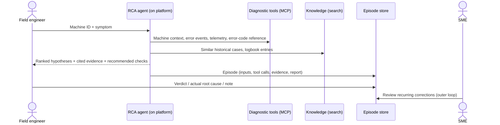

# Specification: CS AI Platform, validated with AI-assisted diagnostics

- **Status:** Living document, iteration 1
- **Related:** [Implementation plan](plan-iteration-1.md) · [Candidate Azure services](azure-services-candidates.md) · [Decisions (ADRs)](adr/)

This document describes **what** the sample is and **why**. The implementation plan describes **how** and **in what order**. The scenario is generic: a fictional customer-support organization, fictional equipment and synthetic data.

---

## 1. Background

### 1.1 The organization

A **customer support (CS) organization** maintains a large installed base of complex, high-value industrial equipment at customer sites. When a machine goes down or degrades, **field service engineers** diagnose and repair it on site, backed by remote support specialists and subject-matter experts (SMEs).

Every hour of unplanned downtime is expensive for the equipment owner. Diagnostic labor is a major cost driver for the support organization. Reducing **time to diagnosis** and **diagnostic labor hours** is a strategic goal.

### 1.2 Today's diagnostic reality

- **Diagnostic knowledge is fragmented** across many systems: machine telemetry and event logs, error-code references, diagnostic decision trees and knowledge bases, service logbooks, email threads with experts, and historical case records.
- **Diagnosis is slow for hard cases.** Routine failures are well covered by existing diagnostic content. For the long tail, engineers spend hours collecting evidence from several tools before forming a hypothesis, and difficult cases escalate to scarce specialists.
- **Learning from the field is slow.** Insights gained during a repair can take months to flow back into the diagnostic knowledge base, so the same investigation happens repeatedly.

### 1.3 Where AI stands today

The organization has **promising diagnostic agent prototypes**. These are LLM-based agents that gather evidence through tools and propose ranked root causes. They show value, but each prototype is built in isolation and lacks what controlled use by field engineers requires:

- no repeatable path from prototype to production (deployment, environments, CI/CD),
- no consistent observability (what did the agent do, and why?),
- no systematic evaluation (is the new version better or worse?),
- no governed way to learn from expert corrections,
- no shared security, identity and data-access model.

Building one more isolated agent would add to the problem.

## 2. Vision and goals

> Turn diagnostic agent prototypes into production-grade agents on a **minimal, reusable CS AI platform**, and prove it with **one end-to-end diagnostics workflow** in the hands of field engineers.

The approach is **platform-first, validated by a real use case**:

- **G1: Minimum viable platform.** Build only the shared capabilities the first use case needs, designed so further agents and workflows can be onboarded without rebuilding them.
- **G2: Evidence-backed diagnostics.** The first use case is root-cause analysis (RCA). Given a machine and a symptom, produce **ranked root-cause hypotheses**, each backed by **cited evidence**, plus recommended checks.
- **G3: Quality you can measure.** Every agent change is evaluated against a versioned set of cases before it ships.
- **G4: Transparency.** Every agent run can be traced end to end: model calls, tool calls, retrieved evidence, final answer.
- **G5: Learning loop.** Every diagnostic run is captured as a structured episode, and expert corrections flow back under SME control.
- **G6: Developer pathway.** A documented, repeatable way to take an agent from prototype to production.
- **Reuse over rebuild.** Wrap existing diagnostic capabilities (tools, content, prototype logic) instead of re-implementing them.

### Non-goals

- A complete enterprise AI platform. The platform grows with each onboarded use case.
- Replacing human judgment. The agent advises, and the field engineer decides and acts.
- Autonomous actions on equipment. Agents read diagnostic data; they do not change machine state.
- Organizational change, global rollout or adoption programs.

## 3. Users and stakeholders

| Role | Needs from the system |
|---|---|
| **Field service engineer** (primary user) | A fast, evidence-backed diagnosis for the machine in front of them, and an easy way to confirm or correct the result. |
| **Remote support specialist / SME** | Fewer escalations; when escalated, a complete evidence trail instead of starting from scratch. Reviews and approves proposed knowledge updates. |
| **Diagnostic content author / knowledge engineer** | Visibility into where agents fail and why, and governed proposals for new or improved diagnostic content. |
| **Agent developer** | A harness, templates and a repeatable delivery path that make building, evaluating and shipping a new agent routine. |
| **Platform / operations team** | Standardized deployment, identity, telemetry and cost visibility across all agents. |
| **Reliability / analytics team** | Structured episode data to analyze recurring failure modes and diagnostic effectiveness. |
| **Security, compliance and responsible-AI reviewers** | Least-privilege access, auditability, data residency, documented controls. |

## 4. Core workflow: diagnosis to action

1. **Intake.** The field engineer submits a machine identifier and a free-text symptom.
2. **Evidence gathering.** The agent calls diagnostic tools: machine configuration and recent changes, error events in the relevant window, telemetry for implicated signals, and error-code references. It also searches the knowledge base for similar historical cases and logbook entries.
3. **Reasoning.** The agent forms several hypotheses and discriminates between them. Shared error codes alone are not enough, so the agent correlates telemetry trends and recent maintenance history.
4. **Report.** A structured report with ranked hypotheses, a confidence for each, **evidence items that reference concrete records**, and recommended verification checks.
5. **Capture.** The platform, not the LLM, records the full episode.
6. **Feedback.** The engineer confirms or corrects the diagnosis, and the correction is attached to the episode.

## 5. Platform capabilities

| ID | Capability | Description |
|---|---|---|
| **C1** | Agent harness | A shared runtime library: agents are declared by a spec (instructions, model, tools, output schema, eval suite) rather than hand-wired. Common concerns such as telemetry, episode capture and config live here once. |
| **C2** | Model access | Managed model deployments behind identity-based access; the model is configuration, so it can be swapped without changing code. |
| **C3** | Tool layer | Diagnostic data sources exposed as **MCP tools**, curated in a shared toolbox with central authentication and versioning. Read-only by design. |
| **C4** | Knowledge grounding | Search over unstructured diagnostic knowledge (logbooks, historical cases, diagnostic content) with hybrid keyword and vector retrieval. |
| **C5** | Episode store | Durable, structured record of each diagnostic run and its feedback, the raw material for evaluation and learning. |
| **C6** | Observability | End-to-end OpenTelemetry tracing of agent runs, plus logs and metrics (latency, tokens, errors, usage). |
| **C7** | Evaluation | A versioned **case manifest** with expected outcomes; code-based and model-based evaluators; thresholds that act as a **quality gate** (a non-zero exit that any CI can enforce). |
| **C8** | Identity and security | Entra identities for users, agents and services; RBAC everywhere; no keys in code; least privilege. |
| **C9** | Delivery path | Infrastructure as code, one-command environment provisioning, local quality gates (lint, types, tests, evaluation), and a documented route to CI/CD with smoke tests and an evaluation gate on pull requests. |

## 6. The governed learning loop

Learning from the field must be **fast but controlled**: no change reaches the agent's behavior without expert approval.

1. **Inner loop: capture.** Each diagnostic episode is stored as a structured, inspectable record: input, agent reasoning steps, tool calls, evidence, ranked hypotheses and the expert's verdict or correction.
2. **Outer loop: propose.** Episodes are reviewed periodically for recurring patterns, such as systematically missed failure modes, misleading evidence or missing error-code mappings. This produces **proposals** for improved instructions, diagnostic skills, worked examples or knowledge content.
3. **SME gate.** A subject-matter expert approves or rejects every proposal. Nothing changes agent behavior without that approval.
4. **Replay validation.** Approved changes are replayed against comparable past cases, and the evaluation suite must show improvement without regressions before release.

Iteration 1 implements the **inner loop** (capture and feedback). Proposals, the SME gate and replay are planned for iteration 2.

## 7. Requirements

### 7.1 Functional

| ID | Requirement |
|---|---|
| F1 | Accept a diagnostic request: machine identifier, symptom description, optional time window. |
| F2 | Retrieve machine context, error events, telemetry windows and error-code references through tools. |
| F3 | Retrieve similar historical cases and relevant logbook entries through search. |
| F4 | Return a structured report: ranked hypotheses (≥1, ≤5), each with confidence, evidence items (source, record reference, excerpt) and recommended checks. |
| F5 | Every evidence item must reference a record that exists in the source systems; no uncited claims. |
| F6 | Persist every run as an episode with a stable identifier returned to the caller. |
| F7 | Allow an expert to attach feedback to an episode: verdict (correct / partially correct / incorrect), actual root cause, free-text note. |
| F8 | Allow listing and inspecting episodes. |
| F9 | Run the evaluation suite against a local or deployed agent and report pass/fail against thresholds. |
| F10 | Onboarding a second agent requires only a spec, instructions, a toolbox reference and an eval suite; no new infrastructure code. |

### 7.2 Non-functional

| Area | Requirement |
|---|---|
| **Security** | Identity-based access only (Entra ID, managed and agent identities); local and key auth disabled where supported; least-privilege RBAC; tools are read-only. |
| **Data residency** | All resources and model processing in a single geography (default: EU, `swedencentral`, Data Zone deployments). |
| **Privacy** | Diagnostic data treated as confidential; no personal data required; trace content capture configurable. |
| **Observability** | 100% of agent runs traced, with model and tool spans correlated to the episode identifier. |
| **Quality** | Evaluation thresholds enforced by the evaluation gate; changes to agent, tools, prompts or eval data are evaluated before they're merged. |
| **Reproducibility** | Any environment can be created from scratch with one command; key dependencies have minimum versions and the Python version is pinned. |
| **Maintainability** | Typed Python with lint, format and type checks enforced by pre-commit hooks; the harness has unit tests independent of Azure. |
| **Cost** | Serverless or consumption tiers by default; the model is a cheap, modern default that can be overridden. |
| **Responsible AI** | Output is advisory and clearly marked as AI-generated; human confirmation before action; prompt-injection mitigations for content retrieved from logbooks and emails. |

## 8. Success measures

The sample demonstrates the **mechanisms** for measuring success. The targets below are **illustrative**; real values must come from baselines measured with the people who use the system.

| Outcome | Example measure | Where it's measured |
|---|---|---|
| Diagnostic accuracy | Correct root cause in the top 1 / top 3 hypotheses on the case manifest | Evaluation gate |
| Evidence quality | Share of hypotheses with valid, resolvable evidence references | Evaluation gate |
| Diagnostic speed | Time from request to report; field time to diagnosis | Traces; pilot measurement |
| Coverage | Share of in-scope failure modes the agent diagnoses correctly | Evaluation gate; episodes |
| Learning velocity | Time from expert correction to approved knowledge update | Episode store; outer loop |
| Adoption | Share of eligible cases where engineers use the agent; satisfaction | Usage telemetry; surveys |
| Platform reuse | Effort to onboard the next agent | Onboarding guide in practice |

## 9. Scope

### Iteration 1 (this repository)

- Platform harness, telemetry, episode store and feedback (C1–C9 in minimal form)
- One RCA agent over a **synthetic fleet**: 20 machines, 8 failure modes, 18 incident scenarios
- MCP tool server, search-backed knowledge, evaluation gate, CLI, IaC; CI/CD documented but not active

### Later iterations

- Outer learning loop: proposals, SME approval workflow, replay validation
- AI gateway (API Management) in front of models and tools
- Private networking
- Ingestion of unstructured documents (PDFs, emails) with content extraction
- Real-time telemetry analytics store
- Additional channels (e.g. Teams), additional agents and multi-agent workflows (e.g. action planning, repair and recovery)
- Model comparison across providers
- Edge deployment

## 10. Synthetic domain

All data in this repository is **fictional** and generated deterministically. It contains no real organizations, machines or customer data. The domain is designed to make RCA non-trivial:

- **Failure modes** each have a root cause, error codes, a telemetry signature, symptom phrasings, recommended checks and logbook clues.
- **Shared error codes** across failure modes, so codes alone cannot determine the root cause.
- **Telemetry** (hourly, 7 days, 8 signals per machine) with failure signatures that start at incident onset and ramp in.
- **Logbook entries** with genuine clues (e.g. recent maintenance) as well as routine noise and **red herrings**.
- **Historical cases** with confirmed root causes, as retrieval material.
- **Scenarios**, active incidents with a known expected failure mode, which form the ground truth for evaluation.

## 11. Assumptions and open questions

Assumptions:

- An Azure subscription with permission to create resources and role assignments.
- Preview features (hosted agents, toolboxes, parts of tracing and evaluation) are acceptable for a sample, and versions are pinned.

Open questions for adopting the pattern in a real organization:

- Which existing diagnostic systems become MCP tools first, and who owns them?
- What are the baseline metrics, and who signs off on the evaluation thresholds?
- Which components and services are approved for use, and which existing IaC must be reused?
- Who are the SMEs for the learning loop, and what is their review capacity?
- Where do the boundaries lie between advisory output and actions that need formal procedures?

## 12. Glossary

| Term | Meaning |
|---|---|
| **RCA** | Root-cause analysis: identifying the underlying cause of a failure. |
| **Agent** | An LLM-driven program that uses tools to gather information and produce a result. |
| **Harness** | The shared platform library that hosts agents and provides common capabilities. |
| **MCP** | Model Context Protocol: a standard interface for exposing tools to agents. |
| **Toolbox** | A curated, versioned bundle of tools behind a single MCP endpoint. |
| **Episode** | The structured record of one diagnostic run, including feedback. |
| **Case manifest** | The versioned set of evaluation cases with expected outcomes. |
| **Evaluation gate** | A check that fails when evaluation results fall below thresholds; runs locally and in any CI. |
| **SME** | Subject-matter expert. |
| **Failure mode** | A known way a machine can fail, with characteristic symptoms and evidence. |
