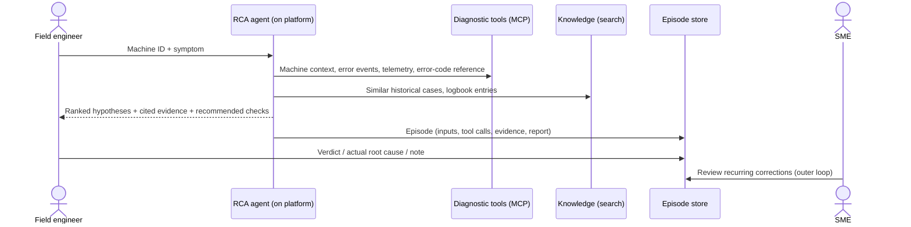

# Specification: CS AI Platform, validated with AI-assisted diagnostics

This document describes **what** the sample is and **why**. The [architecture](architecture.md) describes **how**. The scenario is generic: a fictional customer-support organization, fictional equipment and synthetic data.

## 1. Background

A **customer support (CS) organization** maintains a large installed base of complex industrial equipment at customer sites. When a machine goes down, **field service engineers** diagnose and repair it, backed by remote specialists and subject-matter experts (SMEs). Downtime is expensive, and diagnostic labor is a major cost, so **time to diagnosis** matters most.

- **Knowledge is fragmented** across telemetry and event logs, error-code references, decision trees, service logbooks, expert emails and historical cases.
- **Hard cases are slow.** For the long tail, engineers spend hours collecting evidence before forming a hypothesis, and difficult cases escalate to scarce specialists.
- **Learning from the field is slow.** Insights from a repair can take months to reach the knowledge base.

The organization has promising **diagnostic agent prototypes**, but each is built in isolation, without a path to production, observability, systematic evaluation, a governed way to learn from expert corrections, or a shared security model. One more isolated agent would add to the problem.

## 2. Vision and goals

> Turn diagnostic agent prototypes into production-grade agents on a **minimal, reusable CS AI platform**, and prove it with **one end-to-end diagnostics workflow** in the hands of field engineers.

The approach is **platform-first, validated by a real use case**:

- **G1: Minimum viable platform.** Build only the shared capabilities the first use case needs, designed so further agents and workflows can be onboarded without rebuilding them.
- **G2: Evidence-backed diagnostics.** The first use case is root-cause analysis (RCA). Given a machine and a symptom, produce **ranked root-cause hypotheses**, each backed by **cited evidence**, plus recommended checks.
- **G3: Quality you can measure.** Every agent change is evaluated against a versioned set of cases before it ships.
- **G4: Transparency.** Every agent run can be traced end to end: model calls, tool calls, retrieved evidence, final answer.
- **G5: Learning loop.** Every diagnostic run is captured as a structured episode, and expert corrections flow back under SME control.
- **G6: Developer pathway.** A documented, repeatable way to take an agent from prototype to production.
- **Reuse over rebuild.** Wrap existing diagnostic capabilities (tools, content, prototype logic) instead of re-implementing them.

### Non-goals

- A complete enterprise AI platform. The platform grows with each onboarded use case.
- Replacing human judgment. The agent advises, and the field engineer decides and acts.
- Autonomous actions on equipment. Agents read diagnostic data; they do not change machine state.
- Organizational change, global rollout or adoption programs.

## 3. Users

| Role | Needs |
|---|---|
| **Field service engineer** (primary user) | A fast, evidence-backed diagnosis, and an easy way to confirm or correct it. |
| **SME and content author** | A complete evidence trail on escalation; visibility into where agents fail; approval of every proposed knowledge change. |
| **Agent developer** | A harness and a repeatable path for building, evaluating and shipping an agent. |
| **Platform, security and compliance** | Standard deployment, identity, telemetry, cost visibility, least privilege, auditability and data residency. |

## 4. Core workflow: diagnosis to action

The agent gathers evidence with tools and search, discriminates between hypotheses (shared error codes alone aren't enough), and reports ranked hypotheses with cited records and recommended checks. The platform, not the model, records the episode, and the engineer's verdict is attached to it.

## 5. Platform capabilities

| ID | Capability | Description |
|---|---|---|
| **C1** | Agent harness | A shared runtime library: agents are declared by a spec (instructions, model, tools, output schema, eval suite) rather than hand-wired. Common concerns such as telemetry, episode capture and config live here once. |
| **C2** | Model access | Managed model deployments behind identity-based access; the model is configuration, so it can be swapped without changing code. |
| **C3** | Tool layer | Diagnostic data sources exposed as **MCP tools**, curated in a shared toolbox with central authentication and versioning. Read-only by design. |
| **C4** | Knowledge grounding | Search over unstructured diagnostic knowledge (logbooks, historical cases, diagnostic content) with hybrid keyword and vector retrieval. |
| **C5** | Episode store | Durable, structured record of each diagnostic run and its feedback, the raw material for evaluation and learning. |
| **C6** | Observability | End-to-end OpenTelemetry tracing of agent runs, plus logs and metrics (latency, tokens, errors, usage). |
| **C7** | Evaluation | A versioned **case manifest** with expected outcomes; code-based and model-based evaluators; thresholds that act as a **quality gate** (a non-zero exit that any CI can enforce). |
| **C8** | Identity and security | Entra identities for users, agents and services; RBAC everywhere; no keys in code; least privilege. |
| **C9** | Delivery path | Infrastructure as code, one-command environment provisioning, local quality gates (lint, types, tests, evaluation), and a documented route to CI/CD with smoke tests and an evaluation gate on pull requests. |

## 6. The governed learning loop

Learning from the field must be **fast but controlled**: no change reaches the agent's behavior without expert approval.

1. **Inner loop: capture.** Each diagnostic episode is stored as a structured, inspectable record: input, agent reasoning steps, tool calls, evidence, ranked hypotheses and the expert's verdict or correction.
2. **Outer loop: propose.** Episodes are reviewed periodically for recurring patterns, such as systematically missed failure modes, misleading evidence or missing error-code mappings. This produces **proposals** for improved instructions, diagnostic skills, worked examples or knowledge content.
3. **SME gate.** A subject-matter expert approves or rejects every proposal. Nothing changes agent behavior without that approval.
4. **Replay validation.** Approved changes are replayed against comparable past cases, and the evaluation suite must show improvement without regressions before release.

The sample implements the **inner loop** (capture and feedback). Proposals, the SME gate and replay come later.

## 7. Requirements

### 7.1 Functional

| ID | Requirement |
|---|---|
| F1 | Accept a diagnostic request: machine identifier, symptom description, optional time window. |
| F2 | Retrieve machine context, error events, telemetry windows and error-code references through tools. |
| F3 | Retrieve similar historical cases and relevant logbook entries through search. |
| F4 | Return a structured report: ranked hypotheses (≥1, ≤5), each with confidence, evidence items (source, record reference, excerpt) and recommended checks. |
| F5 | Every evidence item must reference a record that exists in the source systems; no uncited claims. |
| F6 | Persist every run as an episode with a stable identifier returned to the caller. |
| F7 | Allow an expert to attach feedback to an episode: verdict (correct / partially correct / incorrect), actual root cause, free-text note. |
| F8 | Allow listing and inspecting episodes. |
| F9 | Run the evaluation suite against the deployed agent and report pass or fail against thresholds. |
| F10 | Onboarding a second agent requires only a spec, instructions, a toolbox reference and an eval suite; no new infrastructure code. |

### 7.2 Non-functional

| Area | Requirement |
|---|---|
| **Security** | Identity-based access only (Entra ID, managed and agent identities); local and key auth disabled where supported; least-privilege RBAC; tools are read-only. |
| **Data residency** | All resources and model processing in a single geography (default: EU, `swedencentral`, Data Zone deployments). |
| **Privacy** | Diagnostic data treated as confidential; no personal data required; trace content capture configurable. |
| **Observability** | 100% of agent runs traced, with model and tool spans correlated to the episode identifier. |
| **Quality** | Evaluation thresholds enforced by the evaluation gate; changes to agent, tools, prompts or eval data are evaluated before they're merged. |
| **Reproducibility** | Any environment can be created from scratch with one command; key dependencies have minimum versions and the Python version is pinned. |
| **Maintainability** | Typed Python with lint, format and type checks enforced by pre-commit hooks; the harness has unit tests independent of Azure. |
| **Cost** | Serverless or consumption tiers by default; the model is a cheap, modern default that can be overridden. |
| **Responsible AI** | Output is advisory and clearly marked as AI-generated; human confirmation before action; prompt-injection mitigations for content retrieved from logbooks and emails. |

## 8. Success measures

The sample shows the **mechanisms**; real targets need baselines measured with the people who use the system.

| Outcome | Measure | Where |
|---|---|---|
| Accuracy and evidence quality | Correct root cause ranked first; cited references valid | Evaluation gate |
| Speed | Time from request to report | Traces |
| Learning velocity | Time from expert correction to approved update | Episodes; outer loop |
| Adoption and reuse | Use by engineers; effort to onboard the next agent | Telemetry; onboarding in practice |

## 9. Scope

### In this repository

- Platform harness, telemetry, episode store and feedback (C1–C9 in minimal form)
- One RCA agent over a **synthetic fleet**, with 50 test cases: 18 clean incidents and 32 challenge cases
- MCP tool server, search-backed knowledge, IaC with azd, a small CLI for episodes and feedback; CI/CD documented but not active
- Evaluation of the deployed agent in Foundry with a read-only quality gate ([ADR 0011](adr/0011-foundry-evaluation-and-measured-gate.md)); not of a local agent, and not enforced by CI

### Later

- Outer learning loop: proposals, SME approval workflow, replay validation
- AI gateway (API Management) in front of models and tools
- Full private networking (today the data stores are private; Foundry, registry and search stay public)
- Ingestion of unstructured documents (PDFs, emails) with content extraction
- Real-time telemetry analytics store
- Additional channels (e.g. Teams), additional agents and multi-agent workflows (e.g. action planning, repair and recovery)
- Model comparison across providers
- Edge deployment

## 10. Synthetic domain

All data in this repository is **fictional** and generated deterministically. It contains no real organizations, machines or customer data. The domain is designed to make RCA non-trivial:

- **Failure modes** each have a root cause, error codes, a telemetry signature, symptom phrasings, recommended checks and logbook clues.
- **Shared error codes** across failure modes, so codes alone cannot determine the root cause.
- **Telemetry** (hourly, 7 days, 8 signals per machine) with failure signatures that start at incident onset and ramp in.
- **Logbook entries** with genuine clues (e.g. recent maintenance) as well as routine noise and **red herrings**.
- **Historical cases** with confirmed root causes, as retrieval material.
- **Scenarios**, active incidents with a known expected failure mode, which form the ground truth for evaluation.

## 11. Assumptions and open questions

Preview features (hosted agents, toolboxes, parts of tracing and evaluation) are acceptable for a sample. For a real adoption, settle first: which diagnostic systems become tools and who owns them; who signs off on evaluation thresholds; which services and existing IaC are approved; who the SMEs are and how much they can review; and where advisory output ends and formal procedures begin.

## 12. Glossary

| Term | Meaning |
|---|---|
| **RCA** | Root-cause analysis: finding the underlying cause of a failure. |
| **Harness** | The shared platform library that hosts agents. |
| **Toolbox** | A Foundry bundle of tools behind one MCP endpoint. |
| **Episode** | The platform's record of one agent run, with its feedback. |
| **Evaluation gate** | A check that fails when evaluation results fall below thresholds. |
